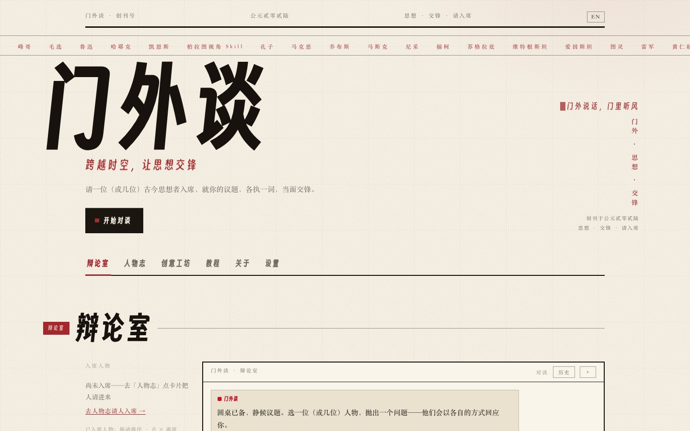

# 门外谈 · Menwai Tan

**An AI thinkers' debate club — talk, argue, and clash with a roster of distilled personas.**

[English](README.en.md) · **中文** ([中文版](README.md)) · 🌐 [Live Demo](https://very-validation-toys-features.trycloudflare.com)

   

> Pick a seat, throw a question, and watch Zhang Xuefeng, Luo Xiang, Marx and Confucius argue it out — in a revolutionary editorial aesthetic of paper and ink red.



## Features

- **Roster of thinkers** — one SKILL.md per persona, distilled by the open-source community
- **One-on-one or round table** — chat solo, or pit several thinkers against each other in turns
- **Scene system** — Casual / Serious / Heated control answer length & tone, with auto-escalation
- **Streaming replies** — SSE with a typewriter effect
- **Dossier view** — background, signature quotes and source repo for every persona
- **BYOK** — bring your own API key, or use the built-in free channel (Zhipu GLM-4-Flash)
- **Touch-drag on mobile** — long-press to reorder seats, fully responsive

## Quick Start

```bash
pnpm install
cp .env.local.example .env.local   # fill in your AI_API_KEY (GLM-4-Flash is free)
pnpm dev
```

Open http://localhost:3000. Production build:

```bash
pnpm build && pnpm start -p 3100
```

## Tech Stack

Next.js 16 · React 19 · TypeScript · Tailwind CSS v4 · OpenAI SDK (DeepSeek / Zhipu GLM)

## Credits

Personas distilled from the open-source community; bio excerpts from upstream READMEs — copyright belongs to their authors.

## License

MIT
