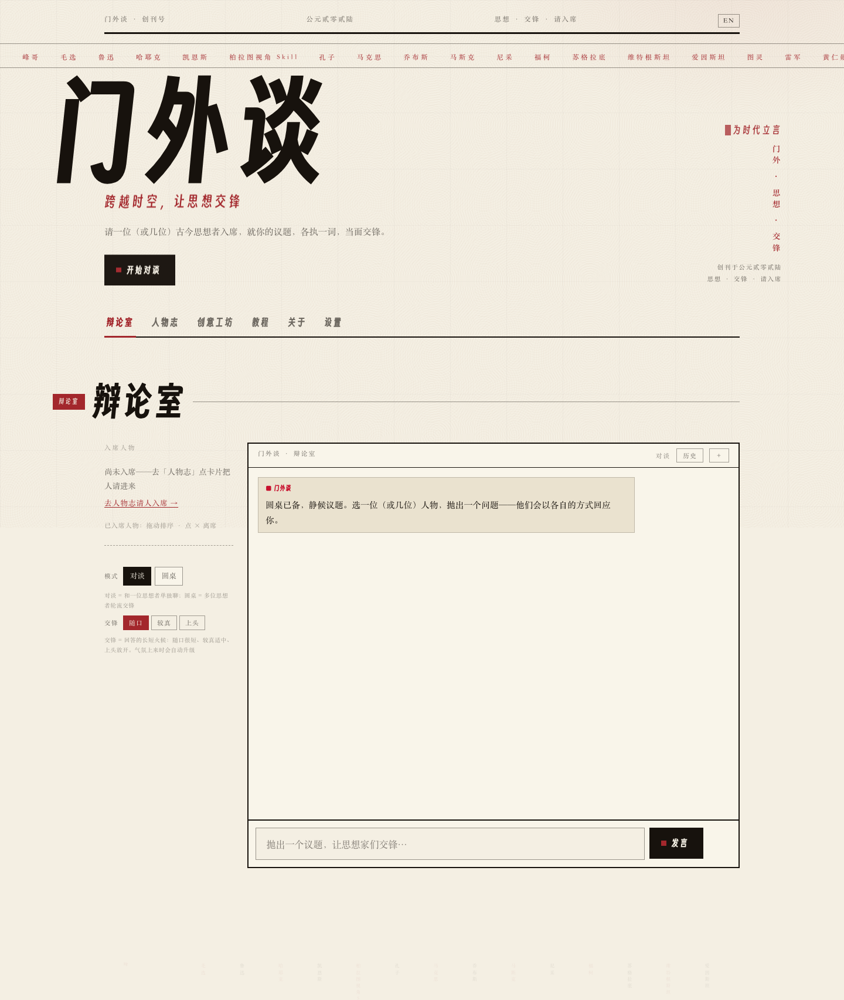

# 门外谈 · Menwai Tan

**一座 AI 思想家辩论场——与多位被蒸馏的人格对谈、交锋、上头。**

[English](README.en.md) · **中文**

   

> 选个位子，抛一个问题，看张雪峰、罗翔、马克思和孔子吵起来——纸墨红的革命美学，文火慢炖。



## 功能

- **思想者阵容** —— 每位思想家一份 SKILL.md，由开源社区蒸馏
- **对谈 / 圆桌** —— 单聊，或让多位思想家轮流交锋
- **场景系统** —— 随口 / 较真 / 上头 控制回答长短与火候，气氛上来自动升级
- **流式回复** —— SSE 打字机效果
- **人物志** —— 每位的背景、名言、源码仓库
- **BYOK** —— 自带 API key，或直接用内置免费通道（智谱 GLM-4-Flash）
- **触屏拖拽** —— 手机长按调整座位，全端响应式

## 快速开始

```bash
pnpm install
cp .env.local.example .env.local   # 填入你的 AI_API_KEY（GLM-4-Flash 免费）
pnpm dev
```

打开 http://localhost:3000。生产构建：

```bash
pnpm build && pnpm start -p 3100
```

## 技术栈

Next.js 16 · React 19 · TypeScript · Tailwind CSS v4 · OpenAI SDK（DeepSeek / 智谱 GLM）

## 致谢

人格由开源社区蒸馏；简介摘自各上游 README，版权归原作者所有。

## 许可证

MIT
