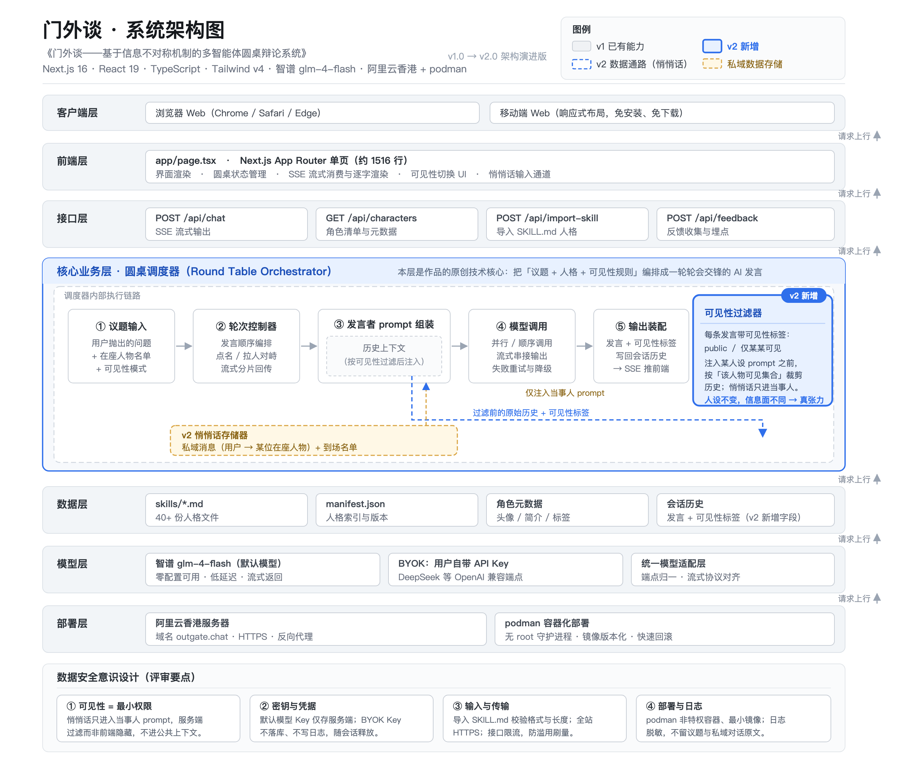

# 门外谈——基于信息不对称机制的多智能体圆桌辩论系统

## 一、作品基本信息

| 项目 | 内容 |
| --- | --- |
| 作品名称 | 门外谈——基于信息不对称机制的多智能体圆桌辩论系统 |
| 作品形态 | Web 应用，响应式设计，桌面端与移动端浏览器均可使用 |
| 参赛赛项 | 自主选题类 ·（二）移动与网络应用开发类赛项 |
| 访问地址 | https://outgate.chat （免费开放，无需注册与登录） |
| 完成人 | 冯思涵（哈尔滨金融学院 商务英语 2026 级本科生）、张耀羽（哈尔滨金融学院 会计学 2025 级本科生） |
| 指导教师 | 胡芳驰（第一指导教师）、霍镜宇（第二指导教师 · 校赛联络员） |
| 版本情况 | 本作品有两版：**第一版**（2026 年 8 月上线并公开推广，下文称 **v1**）与**本届参赛版**（在第一版基础上新增「信息不对称机制」，下文称 **v2**） |

作品的核心交互是「与多位思想者对谈，并让他们同桌交锋」：用户从 35 位可对话人格中选择 1 位单人对谈，或选择 2 位以上组成圆桌辩论。界面采用新文化运动时期报刊的纸墨红视觉语言，全站中英双语。

## 二、需求分析与目标用户

### 2.1 想法从哪来

最初的目的很简单：想找个能真正交流的 AI。

日常用 AI 问问题，得到的回答大多很客气。问「我该不该放弃这个专业」，回答是「这取决于你的兴趣和目标」；问「我这样想对不对」，它先说「你的想法很有道理」。次数多了会发现，聊完之后那个疑问还在原处。

后来在 GitHub 上看到，有人把名人整理成可以对话的人格包（SKILL.md），接入之后 AI 会用那个人的语气说话。试了几个，比较意外的是这些角色并不好说话：问鲁迅该不该退学，他并不分析利弊，而是反问——凭什么认为退学是一条路。这种被追问的感觉，比被安慰更有用。

不过一次只能和一个人对话，本质上仍然是我问他答。我更好奇的是他们彼此之间的分歧：把鲁迅和乔布斯放在一起讨论「要不要为了稳定放弃热爱」，这两位的立场几乎不可能调和。

**于是做了圆桌：提出一个议题，几位依次发言，后发言的人能看到前面说了什么。** 这是第一版（v1）的核心创意，2026 年 8 月上线并公开推广。

### 2.2 需求起点

单模型对话有两个具体缺陷。一是**立场坍缩**：模型顺着用户既有观点展开，用户得到的是"一个平均答案"，听不到真正的反对意见。二是**多智能体趋同**：多位人格共享同一份历史，数轮之内便互相附和，收敛为没有交锋的表面共识。

本项目从第二个问题切入：其根源不在人格设定不够鲜明，而在**信息分配方式**——所有人共享同一份上下文时，个体差异只能在语气层面残留。第一版（v1）以加强人格锚定缓解该现象，本届参赛版（v2）直接从信息层解决。

### 2.3 目标用户

**目标用户**：高校师生（通识与思政课的思辨训练与讨论素材）、内容创作者（观点碰撞与选题角度）、网络文化用户（查询陌生热梗）、中英双语用户。

共同特征是**使用门槛低**：不愿注册、不愿付费，多用手机浏览。因此作品免费、无登录、移动端优先；免费通道由内置的智谱 GLM-4-Flash 提供，零配置即可使用，用户也可填入自己的 API Key 与模型名（BYOK），兼容任意 OpenAI 兼容接口的模型服务。

## 三、作品功能模块与业务流程

### 3.1 功能模块

| 模块 | 具体能力 |
| --- | --- |
| 人格库 | 35 位可对话人格，由 3 位内置与 32 位社区人格（`skills/manifest.json`）合并生成 |
| 单人对谈 / 圆桌辩论 | 选 1 位一对一对话；选 2 位以上按可调整的顺序轮流交锋 |
| 语气控制 | 随口 / 较真 / 上头三档，约束单次回复长度与论证强度 |
| 网络热梗查询 | 识别"XX 是什么意思 / 什么梗"类提问后自动联网检索并标注来源 |
| 创意工坊 | 输入含 SKILL.md 的 GitHub 仓库地址，导入为新人格 |
| 双语、流式与打断 | 中 / EN 切换与语言跟随；SSE 逐字输出，支持停止与插话打断；含历史记录与反馈入口 |

### 3.2 业务流程

- **公开讨论**：选人入席（1 位对谈，2 位以上圆桌）→ 调整顺序 → 提问 → 各人格按顺序流式生成，后发言者读到此前全部公开发言。
- **查梗支线**：命中热梗触发词 → 并发请求多个免费检索源 → 结果注入本轮提示词、正文前显示来源行；失败静默跳过。
- **导入支线**：粘贴 GitHub 仓库地址 → 服务端深度 1 克隆 → 校验 SKILL.md → 写入人格注册表。
- **信息层流程（v2 新增，本届参赛核心）**：用户对某位在座人格发送**悄悄话**，内容仅其可见；公开发言可标记**可见性**为"仅某某可见"。生成每位发言者的回复时只投喂其有权读到的历史。A 从悄悄话得知"B 不赞同你"后，会在公开发言中主动把 B 拉入讨论。每轮结束计算**信息新颖度**，判定讨论趋同时先强制提出反对意见，仍无新信息则由**主持人收尾**拆穿伪共识。

三档语气是写入系统提示词的硬约束：**随口** ≤2 句 / 60 字，**较真** ≤6 句 / 300 字，**上头**不设上限。

## 四、核心创新：信息不对称机制

### 4.1 问题所在：共享上下文的代价

把多个角色放进同一份会话上下文，是最省事的实现方式——每个角色都能读到他人的全部发言，不需要维护任何权限关系。

代价是可预期的：既然人人都知道别人说了什么，最省力的策略就是附和、复述与折中。讨论数轮之后，交锋会退化成轮流发言。

这是信息结构决定的，不是人格写得不够像。也正因如此，只调人格提示词解决不了这个问题。

### 4.2 v2 的做法：给圆桌加一层信息层

v2 的核心改动是**让不同发言者掌握的上下文不再相同**，由四个机制构成（前三个构成信息层，第四个负责在讨论空转时介入）。

- **可见性**：每条发言带可见范围标记，取值为 `public` 或"仅某某可见"。生成回复时先按该发言者的权限过滤历史，只把其有权读到的部分拼入提示词。
- **悄悄话**：用户私下对某一位在座人格说话，内容不进入其他人的可见历史。入口为**输入框左侧常驻的「私下说」按钮**（点开弹出在座人物清单，选中后按钮变红并显示对方名字），人物卡片上另有「私」快捷按钮；首次使用时出现一次性引导，用户看过即永久不再打扰。被私下告知者获得独有信息，其公开发言带上其他角色无法追溯的依据。用户由此从"提问者"变为"信息的分配者"。
- **点名拉人对峙**：前两个机制的涌现结果。A 会在公开发言中主动把 B 拉进讨论并要求其表态，讨论因此从轮流陈述变为带有暗流的博弈：某些冲突的起因只有用户与当事角色知道，其余角色只能从公开信息中推断。被点名者会收到"不许用『我同意』开场"的约束，避免冲突被客套消解。
- **讨论停滞判据与主持人收尾**：把每轮发言切成字符 2-gram，与此前全部内容比较"不重叠率"作为该轮的信息新颖度（纯本地计算，不额外调用模型）。新颖度低于阈值即判定讨论在互相附和，此时先向所有发言者注入"必须提出反对意见或新角度"的指令；若一轮试过仍未产生新信息，则由「门外谈」本人（不属于桌上任何立场）出面收尾，直接指出表面共识为何是空的、真正的分歧在哪、哪个问题始终无人回答。

### 4.3 与现有产品的差异对比

左列是**本项目 v1 的做法**（所有角色共享同一份上下文），右列是 v2 的做法。这里比较的是两种信息结构，不是评价任何其他产品。

| 对比维度 | 共享上下文（v1 的做法） | 信息层（v2 的做法） |
| --- | --- | --- |
| 上下文分配 | 全员共用一份上下文 | 按发言者过滤，各人可见历史不同 |
| 用户角色 | 公开发问者 | 公开提问者 + 私下信息分配者 |
| 讨论走向 | 数轮内趋同，形成表面共识 | 出现立场迁移、点名对峙与信息优势 |
| 冲突来源 | 人格设定的语气差异 | 人格差异 + 真实的信息差 |

### 4.4 为什么是实质性改进而非功能堆叠

信息不对称改变的是系统的**信息结构**：原本单一的上下文管道要变成"按接收者筛选"的管道。它把讨论从角色扮演式的轮流发言，推向每个参与者基于不同信息独立判断——人类圆桌的张力恰恰来自"我知道一些你不知道的事"。

【实现状态：v2 四个机制已在开发分支 `cmit-2026` 完成编码（提交 `0bc0458` → `969d97e`），并通过 `tsc --noEmit` 与 `next build` 验证；接口与前端入口均已接通，已在浏览器中完成端到端实测。上线状态见第八章。】

## 五、技术路线与系统架构

### 5.1 技术选型

- **前端**：Next.js 16.3.1（App Router）+ React 19.2.8，TypeScript 5.9 全量类型约束；
- **样式与动效**：Tailwind CSS v4 承担布局与主题，GSAP 与 ogl / three.js 承担背景与滚动动效；
- **模型接入**：OpenAI 兼容 SDK，服务端通过 `AI_API_KEY`、`AI_BASE_URL`、`AI_MODEL` 配置，默认智谱 glm-4-flash；
- **人格注册表**：`lib/skills.ts` 读取 `skills/` 与 `skills/manifest.json`，负责元信息、提示词拼装与导入写入；
- **部署**：阿里云香港服务器，podman 容器运行 Node 20 生产镜像。

（部署形态：**阿里云香港服务器 + podman 容器**；仓库 `Dockerfile` 基础镜像为 `node:20-alpine`。早期曾短暂使用过 Sealos 云，已迁移至当前方案。以线上环境截图为准。）

### 5.2 请求链路

浏览器把人格 ID、会话历史、语气档位、语言与 BYOK 配置提交至 `/api/chat`；服务端按人格 ID 取出元信息与 SKILL.md，拼装系统提示词（人格设定 + 平台规则 + 语言规则 + 本轮语气约束 + 对话纪律条款）；命中热梗触发词时先做多源并发检索并注入摘要。随后按顺序逐位请求模型，以 ReadableStream 通过 `text/event-stream` 逐块下发，前端增量渲染，新发言追加进历史供下一位读取。

### 5.3 架构图

数据流向：浏览器 → Next.js 服务端（人格注册表、提示词拼装、检索）→ 模型服务 / 多源检索 → SSE 回传。

（架构图与交互流程图已生成于 `competition/diagrams/`，含 SVG 与 2× PNG，可直接插入本节。）

### 5.4 关键工程决策

- **语气约束前置**：长度与论证强度写入系统提示词，而非前端截断，避免"表面变短、内容仍在灌水"。
- **检索失败静默降级**：查梗链路任一环节超时或异常均不阻断主对话。
- **人格锚定条款**：提示词明确"你是你自己，不模仿、不复述其他发言者的自称与语气"，回应他人时先明确赞同或反对、再给独立理由。v1 更新记录显示该项曾用于修复 10 位人格被带偏、复读的现象。
- **强制英文兜底**：英文模式注入仅英文规则，并设字符集校验与重试。

## 六、交互设计

- **入席即可用**：首页直接呈现人物列表与人物志，点选头像即入席，无注册、无引导页。
- **视觉语言服务于议题**：纸墨红与印刷质感的新文化运动式设计，把"辩论"放进合适语境。
- **节奏可控**：圆桌可调整谁先开口；回复逐字流式出现，发送键三态（发言 / 停止 / 继续输入），AI 说话时可直接输入新问题插话，已生成内容保留。
- **不强制回到底部**：辩论中可自由上翻阅读历史，仅当贴近底部时才自动滚动，右下角提供"回到最新"。
- **移动端适配**：支持触屏长按调整座位，主要操作可单手持机完成。

## 七、数据安全与隐私保护

- **无账号、无实名**：不设注册登录，不采集姓名、手机号、邮箱等身份信息。
- **API Key 不落服务端**：用户自带的 API Key 与模型名仅存于浏览器本地存储，服务端不持久化保存、不上传第三方；站点内置通道的密钥仅存于服务器环境变量，前端不可见。
- **可见性机制本身就是隐私设计**：可见范围标记在生成层即完成过滤，不可见的历史片段不会进入对应角色的提示词；"其他角色不知道"因此是模型层面的真实不知情，而非仅在界面上隐藏。
- **检索与日志最小化**：热梗检索仅传递从问题中提取的关键词，不传递会话上下文与用户标识；会话与反馈记录以追加写落盘，不含账号关联信息；检索按用户限频（每分钟不超过 2 次）。

## 八、完成度与可验证性

### 8.1 可访问版本与功能完成度

线上地址 https://outgate.chat ，无需注册与安装，浏览器打开即可使用；旧域名自动 308 跳转，历史链接不失效。

v1 所列功能均已在线上版本可用；v2 的信息层机制为本届新增，其完成状态与演示路径见下方标记。

（**当前状态：已上线**。v2 信息层机制已完成开发、验证并**部署到 https://outgate.chat**（2026-10-17 19:03，容器重启后内部自检 HTTP 200）。评审可直接访问线上站点体验全部功能；生产环境接口验证结果为：携带 `whisperOnly` 的请求只产生 1 个发言事件，即悄悄话定向发言在线上生效。界面证据见 `../screenshots/` 的 10 张截图（全部取自线上站点）。）

### 8.2 测试说明

- **功能测试**：按功能清单逐项执行，覆盖选人入席、单聊与圆桌、语气切换、发送 / 停止 / 插话、历史回看、语言切换与导入新人格全流程。
- **异常与中断测试**：无 API Key、Key 失效、模型超时或报错、检索源不可达；生成中点击停止，验证已生成内容固化、加载状态清除。
- **兼容性测试**：桌面端 Chrome / Safari / Edge，移动端 iOS Safari 与 Android Chrome，验证布局与滚动。

（**测试用例表、实测记录与测试环境版本号已单独成文**，见同目录《测试说明》：含 7 个新机制用例 T1–T8 与 7 项 v1 回归 R1–R7，逐条记录预期、实测与结论；环境为 Node.js v26.7.0 / Next.js 16.3.1 / React 19.2.8 / TypeScript 5.9.3 / 智谱 glm-4-flash。）

### 8.3 演示材料与评审通道

功能演示视频与界面截图见 `competition/video/` 与 `competition/screenshots/`。

（截图与演示视频见 `competition/screenshots/` 与 `competition/video/`。本作品**无需登录**，评审可直接访问体验，无测试账号需求。）

## 九、应用推广价值

v1 已于 2026 年 8 月上线并对外公开推广，先后在 B 站、小红书、微信视频号、抖音、YouTube 五个平台各发布一条介绍视频，已获得真实用户的实际使用。

【待确认：各平台视频链接、播放与互动数据、真实用户规模尚未提供，故不列具体数字；建议提交前补充可查证的数据截图。】

价值分析：

- **教育场景可落地**：可作通识与思政课堂的思辨训练工具——无需账号、无需安装，教师可直接投屏或让学生用手机进入同一位思想家阵容。
- **信息差的可讲解性**：用户通过分配悄悄话直观体会"同一件事因信息不同而结论不同"，是可讲解的传播学与博弈论素材，也与完成人的商务英语专业背景相关。
- **内容生产与生态扩展**：圆桌交锋可作自媒体选题与文案素材；创意工坊基于 SKILL.md 导入人格，内容生态可由社区扩展。
- **零门槛与可持续**：免费无登录降低使用阻力，内置免费模型通道使作品在无商业收入时仍可长期开放。

## 十、原创性说明

按赛事要求，本节列明原有成果、新增内容与本届团队贡献。

### 10.1 原有成果（v1）

- **核心构思**：把开源社区已经做好的"名人蒸馏人格"（SKILL.md），从**一次只能跟一个人对话**，扩展成**一桌能互相交锋的圆桌**——提出一个议题，几位依次发言，后发言的人能看到前面说了什么。当时项目自述是"一座 AI 思想家辩论场：选个位子，抛一个问题，看他们吵起来"。
- **v1 自身完成的三项设计**（均早于本届新增的信息层）：
  - **圆桌**：多人轮流发言、后来者读到前文，座位可调；
  - **火候三档**：随口 / 较真 / 上头，用"火候"而非"长度"控制回答的篇幅与语气，气氛上来自动升级；
  - **人物志**：每位人物一份档案，含背景、代表言论与上游仓库地址，人格来源可追溯。
- **作品形态与功能**：门外谈 v1，AI 思想家对谈与圆桌辩论网站，纸墨红报纸风，免费、无登录。
- **视觉语言**：新文化运动时期报刊的纸墨红。定稿前试过报纸夜空、大字报、档案馆、纪念碑、浅色日报、堆叠 3D 日报、冷纸小卡等十余个方向，最终选定当前的纸墨红报刊版面。
- **技术形态**：Next.js 16 + React 19 + TypeScript + Tailwind v4，SSE 流式输出，支持 BYOK 与多模型切换，默认智谱 glm-4-flash。
- **上线与推广状态**：2026 年 8 月上线（outgate.chat），并在 B 站、小红书、微信视频号、抖音、YouTube 各发布过一条介绍视频，已有真实用户。
- **人格来源**：来自上游开源社区的蒸馏成果，作品在致谢中标注版权归原作者所有；应用自身采用 MIT 许可证。

### 10.2 新增内容（v2，本届参赛核心）

在 v1 的圆桌之上增加一层**信息层**，使不同发言者掌握的上下文不再相同：

1. **可见性**：每条发言具有 `public` 或"仅某某可见"的可见范围；生成回复时只向该发言者投喂其可见的历史。
2. **悄悄话**：用户可私下对某一位在座人格说话，其他在座角色看不到该内容。
3. **点名拉人对峙**：A 从悄悄话中得知"B 不赞同你"后，会主动把 B 拉进公开讨论并要求其表态。
4. **讨论停滞判据与主持人收尾**：以字符 2-gram 不重叠率衡量每轮信息新颖度，判定趋同后先强制提出反对意见，仍无新信息则由主持人收尾拆穿伪共识。

四项机制共同构成对"全员共享同一份上下文"式圆桌的实质性改进：前两项制造信息差，第三项让信息差在公开场合显形，第四项保证讨论不会以和气收场。

### 10.3 本届团队贡献

- 完成人为**冯思涵**（哈尔滨金融学院商务英语 2026 级本科生，**非计算机专业出身**）与**张耀羽**（哈尔滨金融学院会计学 2025 级本科生），两人团队参赛，分工见《原创性与知识产权声明》第四节。
- **产品设计、功能定义、界面设计、代码实现与云端部署**均由完成人独立完成；开发中借助 AI 编程工具辅助编写与调试代码，但选题判断、需求取舍与最终验收由完成人自行负责。
- v1 的**全部功能实现、上线部署与多平台推广**由完成人独立完成。
- v2 的**信息不对称机制**由完成人提出设计，包括信息层四个机制、可见性的数据结构与生成层过滤方式、讨论停滞的量化判据，以及与既有圆桌流程的整合方案。
- 参赛材料（本文档、系统说明、功能演示与界面截图）亦由完成人整理。
- 指导教师：胡芳驰、霍镜宇。

## 十一、后续迭代计划

1. **以新颖度作为讨论停滞判据**：目前讨论是否继续依赖轮次与用户手动结束。后续计划对每轮发言计算与既有内容的词汇重叠率或语义新颖度，连续低于阈值即判定趋同，自动提示用户更换议题、追加悄悄话或调整阵容，使"讨论是否还有价值"成为可观测指标。
2. **信息层机制完整化**：补充可见范围编辑、悄悄话历史的分角色视图，以及"信息差消退"提示（私下信息被公开披露后标记该差异已消除）。
3. **评估体系**：做小规模对照测试，在同一议题与阵容下对比两种模式的发言相似度与立场迁移次数，用可复现指标说明改进效果。
4. **人格、语言与稳定性**：扩充人格库与英文人格质量，完善导入人格的安全校验（导入内容仅作系统提示词使用）；补充错误率、首字延迟与中断成功率的线上统计。
