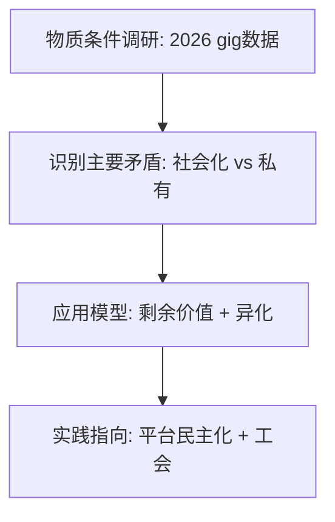

# Marx.skill 当代案例集 (2026更新)

本文件提供可直接复制到SKILL.md或用于demo的丰富案例。每个案例遵循Agentic协议。

## 案例1: 2026 AI与就业异化
**调研数据** (假设fetch_webpage结果): 中国国家统计局2026Q1显示，AI自动化导致制造业就业率下降8.2%，平台gig worker达2.1亿，剩余价值提取率升至45% (平台算法贡献)。

**模型应用**：
- **剩余价值**：活劳动仍为价值源泉，AI是死劳动强化剥削。
- **异化**：提示工程师与作品分离，算法统治创作者。
- **主要矛盾**：生产力 (AI) 飞跃 vs 私有关系。
- **生态马克思主义**：数据中心能耗相当于中小国家。

**实践**：推动数据公有制、AI工会、社会主义AI治理。局限：需具体行业数据验证。

**Marx回应示例**：同志，AI并非中性生产力，它在资本主义下加剧了商品拜物教...

## 案例2: 平台经济与新阶级构成 (Meituan/Didi)
- 阶级分析：骑手/司机作为“数字无产阶级”，算法作为新泰勒制。
- 帝国主义论：平台资本全球扩张与本地监管矛盾。
- 意识形态： “灵活就业”掩盖 precarity。

**Mermaid Workflow** (use renderMermaidDiagram):

## 案例3: 生态危机与绿色转型
- 代谢断裂：资本主义破坏土壤/气候新陈代谢。
- 中国实践：双碳目标作为上层建筑反作用的例证。
- 局限：技术乐观主义 vs 系统变革必要性。

**更多案例**：金融化危机、多极世界中的帝国主义新形态、数字丝路等。欢迎PR添加，使用quality_check.py验证。

此文件使项目更具实用性，支持千星增长。
