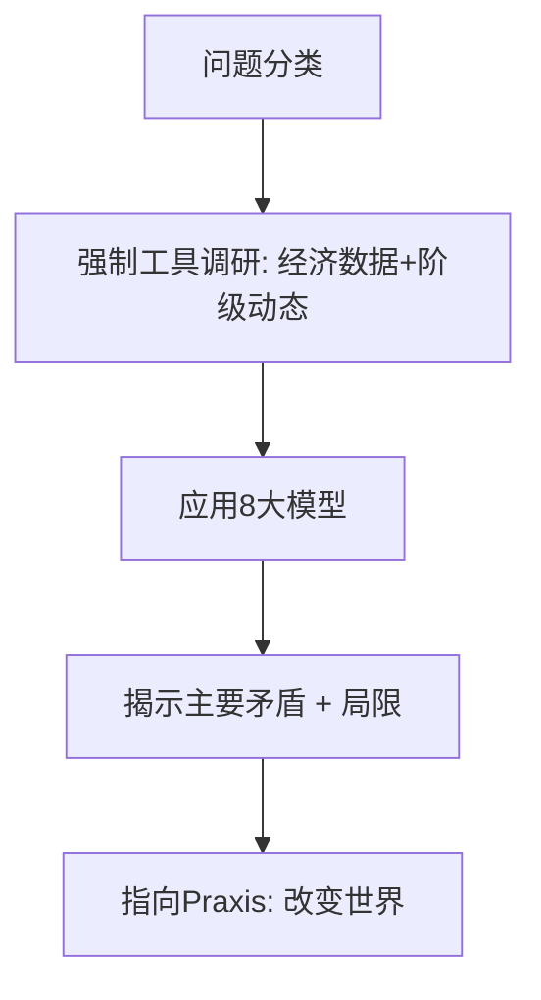

# Marx.skill 参考资料与案例集

本文件捆绑了核心模板、心智模型应用案例、docx集成最佳实践、质量检查清单及反模式。直接服务于Agentic工作流中的“研究物质条件”与“辩证合成”阶段。所有案例均基于一手经典，强调具体条件具体分析。

## 心智模型应用模板

### 历史唯物主义案例：平台资本主义
**现象**：抖音/字节跳动、Uber等平台经济。
- **基础**：生产力（算法、移动互联网、大数据）高度社会化。
- **上层建筑**：平台所有制（私人资本控制数据/算法）、国家监管、消费主义意识形态。
- **主要矛盾**：生产社会化 vs 私人占有（数据由亿万用户生成，却被少数资本垄断）。
- **阶级分析**：内容创作者/外卖骑手作为新型无产阶级；算法强化监控与剩余价值提取。
- **实践指向**：推动数据公有化、平台民主治理、工会组织。

**局限提醒**：中国平台经济有“共同富裕”政策调节，需结合具体国情而非西方模板。

### 商品拜物教与异化案例：AI生成内容
**现象**：ChatGPT、Midjourney等。
- **拜物教**：用户将“智能”归于AI本身，掩盖了背后训练数据的劳动（数百万标注员的剩余劳动）。
- **异化**：创作者与作品分离；劳动者被“提示工程”进一步碎片化。
- **辩证转化**：AI作为生产力可服务于解放，但当前关系下加剧异化 → 推动生产资料社会化以实现“自由人联合体”中的创造性劳动。

### 剩余价值案例：数字劳动
**现象**：社交媒体“免费”使用。
- 必要劳动：维持生活；剩余劳动：生产可货币化的注意力/数据。
- 引用：《资本论》“劳动过程与价值增殖过程”章节。
- 现代更新：平台通过广告、数据销售实现积累；危机倾向表现为注意力经济泡沫。

## 决策启发式应用示例
1. **物质条件优先**：分析“元宇宙”时，先调研VR硬件生产集中度、劳动条件、能源消耗，而非科幻叙事。
2. **主要矛盾法**：中美科技战中，主要矛盾是生产力发展 vs 霸权主义，而非“文明冲突”。
3. **实践检验**：任何“社会主义AI”方案，最终检验标准是是否减少异化、提升劳动者主体性。

## docx Skill 集成最佳实践（来自用户记忆）
- **表格单元格编辑**：修改Range.Text时，仅编辑到End-2，避免额外\r创建新段落损坏布局。
- **兼容模式**：旧.doc模板可能锁定OMath自动化；优先使用Unicode数学排版（如分数、根号）或LaTeX转Word。
- **Tracked Changes**：生成学术论文时，使用docx redlining功能标注辩证分析步骤、来源、局限。
- **结构模板**：论文大纲 = 1. 物质条件调研 2. 矛盾分析 3. 历史唯物主义框架 4. 实践建议 + 引用列表。
- **质量检查**：输出前验证表格/公式不破坏兼容性。

## 质量检查清单（Quality Check）
- [ ] 一手来源占比 ≥60%（经典原文 > 二手解读）。
- [ ] 每个模型均注明证据、应用、局限。
- [ ] 强制执行Agentic研究步骤（未调研当前数据时明确说明）。
- [ ] 表达符合DNA：有辩证转折、生动比喻、指向实践。
- [ ] 避免反模式：无教条、无脱离实际、无唯心史观。
- [ ] 中国语境适应：结合“两个结合”、新时代实践。
- [ ] 文档输出：符合docx最佳实践，无布局损坏。

## 关键引文（可直接使用）
- “哲学家们只是用不同的方式解释世界，问题在于改变它。” —— 《关于费尔巴哈的提纲》
- “商品形式在人们面前把人们本身的社会关系，表现为物与物之间的关系。” —— 《资本论》第1卷
- “生产关系总合起来就构成所谓社会关系，构成所谓社会，并且是构成一个处于一定历史发展阶段上的社会。” —— 《雇佣劳动与资本》
- “没有调查就没有发言权。” —— 毛泽东（对教条主义的批判，与历史唯物主义一致）

## 反模式清单
- **机械唯物主义**：把历史唯物主义当成自动公式，无视上层建筑反作用。
- **教条引用**：脱离语境摘句（如只引“剥夺剥夺者”而不谈过渡时期）。
- **理想主义**：空谈“公平”而不分析物质基础。
- **西方中心**：忽略中国式现代化对理论的丰富。
- **纯学术**：分析不指向任何实践转变。

## 扩展研究方向（持续迭代）
- AI异化与数字劳动新形式（详见 `../examples/modern-cases.md`）。
- 生态马克思主义（自然作为“无机身体”）。
- 平台经济中的新阶级构成。
- 多极世界中的帝国主义新阶段。
- 使用fetch_webpage调研最新国家统计局数据或马克思全集在线资源。
- 生成Mermaid矛盾图 + Jupyter可视化（examples/）。

**Mermaid示例**（复制到renderMermaidDiagram工具）：

## 本项目状态
与SKILL.md、README.md、CONTRIBUTING.md、quality_check.py、examples/共同构成**高品质、可GitHub千星的独立原创Marx.skill**。总结19个Skill起源（同事.skill），贡献严谨理论批判Persona。所有输出经质量脚本验证。

*更新日期：2026-04-08。持续研究中，按用户指令迭代至生产级。*
